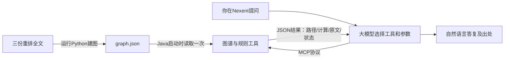

# 三类推理是怎么做出来的

你需要先分清三件事：**Python把原文整理成数据，Java按规则查数据和计算，大模型决定调用哪个工具并把结果说清楚。**模型不会自己在硬盘上寻找JSON，也没有把整份图谱永久“学进脑子”。

**想知道具体代码怎样完成这些步骤，请接着读[从原文到两跳查询：逐行代码讲解](D:/JavaProject/huawei/nexent-cognitive-agent/docs/09-从原文到两跳查询-逐行代码讲解.md)。**其中展开了默认路径、原文分块、正则规则、节点和边生成、Java邻接表、限定两跳查询及通用遍历，并链接到真实源码行。当前建图主要使用人工词表与规则；不是调用大模型自动构建全文图谱。

## 1. 一次提问到底发生什么



比如模型发出`resolve_regimen(population="高血压合并糖尿病患者")`。Nexent通过MCP把参数交给Java。Java在内存中的图谱查关系，返回结果JSON。模型本轮实际拿到的是**一份工具响应**，里面有两条路径、条件和原文；不是Python代码，不是一个神秘的“知识包”。

`pipeline/build_graph.py`是建图入口；`java-mcp/spring-ai-mcp-server/src/main/java/com/example/ict/mcp/McpServerApplication.java`是Java服务启动入口；Nexent是提问入口。修改JSON后，当前Java服务必须重启，才会加载新快照。只改智能体草稿也不会改变首页，仍需要发布。

## 2. 第一题：为什么不能随便补一条complicates

“高血压→合并→糖尿病”若不带人群条件，容易被误读成所有高血压患者都有糖尿病。把它连上药物，图虽然通了，医学语义却可能错了。

本轮增加的是一个明确的人群节点“高血压合并糖尿病患者”，用`hasCondition`说明这个人群包含哪两项疾病条件；**没有制造所有高血压都合并糖尿病的全局断言**。

真正用于回答的路径是：

```text
高血压合并糖尿病患者
    ← preferredRegimenFor（首选方案）— A方案
    — hasAlternativeComponent（同组择一成分）→ ACEI
                                             或 ARB
```

实际存储的方向是“方案→适用人群”，查询从人群反向找方案，因此工具返回`forward=false`。这只是倒着查询，不是偷偷反转原关系的含义。

第一跳来自“合并糖尿病：首选A，血压未达标者加用C或D。”第二跳来自§5.4.2对A的定义。§5.4.4还有“不宜联合应用ACEI与ARB”，所以`selection=one_of`表示二者择一，不能把两个选项拼成联用处方。工具只连**同一个regimen_group**的关系，防止把心肌梗死场景下的A+B方案混入糖尿病场景。

实际验收的两个末端节点为：

- `血管紧张素转换酶抑制剂`（ACEI）；
- `血管紧张素II受体阻滞剂`（ARB）。

两条路径均为2跳。它们是同一指南跨小节的证据组合，**不能把本题包装成跨文档多跳**。两跳组合也不等于已经评估某位患者的禁忌、肾功能或完整治疗方案。

还有一处必须如实披露：重排文本把糖尿病首选句放到了PDF物理第9页的5.4.6.1文本块。记录保留`section=5.4.6.1`，另列`semantic_section=5.4.3.2`，标记`needs_layout_review`，分数限制为0.55。没有为了漂亮出处把它改写成“第8页已确认”。A定义的真实位置是第6页§5.4.2；不宜联用的限制在第9页§5.4.4。正式材料仍应回看PDF核验版面归属。

**你可以做的小实验**：运行下面的命令，找到`paths`，逐条看`steps`里的`relation`、`forward`、`regimen_group`、`file/page/section/evidence`。你看到的这些字段就是模型拿到的取证结果。

```powershell
python -X utf8 java-mcp/query_mcp.py regimen 高血压合并糖尿病患者
```

## 3. 第二题：140/90为什么不是两个数字这么简单

原始候选中数字很多，140/90可能是诊断边界、治疗目标，也可能只是讨论或表格碎片。不能见到数字就提升成已确认规则。

本轮新增`ontology/decision_rules.json`，要求在同一节同时匹配两处原文：

1. “4周内非同日3次规范测量的诊室血压均≥140/90 mmHg。”
2. 表1中“收缩压≥140 mmHg和(或)舒张压≥90 mmHg”。

数字一致且出现明确的“和(或)”才创建可执行的数学结构。若一处缺失或数字不一致，不创建该执行规则，原来的数值候选仍全部保留。

`thresholds`增加收缩压、舒张压两条边界，`decision_rules`记录OR组合和复测前提。`derived_from`指向仍保留的原候选；`verification`依然是pending。**可计算和已审核是两种状态。**

Java计算的是：

```text
收缩压 ≥ 140  OR  舒张压 ≥ 90
```

| 输入mmHg | 达到这条诊室参考边界 | 解释 |
|---|---|---|
| 140/90 | 是 | 两个指标都达到 |
| 140/89 | 是 | 收缩压达到即可 |
| 139/90 | 是 | 舒张压达到即可 |
| 139/89 | 否 | 未达到这条边界；不能据此排除高血压 |

工具将“边界比较”与“条款前提检查”分别返回。没有测量方式或复测记录时，`protocol_status=insufficient_or_unmet_conditions`。用户说的是家庭测量时，诊室规则返回不适用，不暗中套用。复测记录有日期时，还检查是否非同日、至少3次、跨度不超过28天、每次达到边界及是否声明规范测量。

即使所报条件齐全，工具也只报告“符合待核验条款的所报条件”，`sufficient=false`，不自动给人确诊。

```powershell
python -X utf8 java-mcp/query_mcp.py bp --sbp 140 --dbp 90
python -X utf8 java-mcp/query_mcp.py bp --sbp 139 --dbp 90
python -X utf8 java-mcp/query_mcp.py bp --sbp 140 --dbp 90 --method home
```

## 4. 第三题：“必须配备”和“不作一线”为何能同时成立

不能只抽“β阻滞剂＋推荐/不推荐”几个词，还要知道**谁、在哪种用途下**执行什么动作。

| 原文来源 | 主体/人群 | 动作与目的 |
|---|---|---|
| WS/T872—2025，§4.2，物理第3页 | 基层医疗卫生机构 | 至少配备五类降压药，是药物保障 |
| 基层指南2025，§1.3，物理第2页 | 基层医疗卫生机构 | 配备药物 |
| 临床指南文内刊期2024，CQ13，物理第15页 | 无临床合并症的高血压患者 | 不建议β阻滞剂作为一线初始降压药 |

机构备有某类药，不代表每位患者首选它；某人群初始治疗不首选，也不等于所有情境禁用。`detect_conflicts`因此返回`not_conflicting_different_purpose`，并附两边原文。它只说明这两条要求的用途不同，不能证明三份全文完全没有冲突。

本轮也补了反例：临时测试夹具人为加入**同范围、同条件**的一条正向一线推荐，与原来的否定推荐比较，工具返回`potential_conflict_same_scope`。若范围或条件不足，就返回`scope_or_condition_requires_review`。这些合成记录只存在于测试临时文件，未写入真实图谱，不能冒充发现了指南真冲突。

临床文件名含2025，但文内刊期为2024。第一轮模型仍沿用文件名写错年份，因此工具响应增加`source_documents`，把实际年份及版本警告和对照证据一起返回；不能只靠一句提示词要求模型猜对年份。

```powershell
python -X utf8 java-mcp/query_mcp.py conflicts β受体阻滞剂
```

## 5. 怎么自己测试，不用读Python源代码

10月18日验收时服务已启动；后续使用需先确认8081服务仍在运行。可在项目根目录双击`验证三类推理.cmd`，或在终端执行：

```powershell
python -X utf8 eval/run_reasoning_acceptance.py
```

它走真实HTTP/SSE，不是直接读JSON冒充工具接通。屏幕逐项显示PASS，完整参数和响应写到`docs/validation/reasoning-mcp-acceptance.json`。先看`cases[].name/passed`，再按题看`result`。这份记录不包含大模型问答；首页验收记录另存，不能混为一谈。

如果服务已停止：用IDEA运行`McpServerApplication`，或在项目根目录运行打包好的服务：

```powershell
java -jar java-mcp/spring-ai-mcp-server/target/spring-ai-mcp-server-0.1.0.jar
```

8081端口同一时间只能启动一个服务。若已有服务正在占用它，不需要再启动第二个。源码改动要重新编译打包；原始文档改动要重新建图并重启服务。

## 6. 哪些代码分别负责什么

| 文件 | 你要理解的职责 |
|---|---|
| `ontology/clinical_relation_rules.json` | 根据三份全文各自语义定义临床关系，糖尿病场景增加A方案 |
| `pipeline/clinical_extractor.py` | 记录两处原文、同方案组、择一/联用限制，不确定结果留存 |
| `ontology/decision_rules.json`、`pipeline/decision_extractor.py` | 血压边界与复测协议的明确结构化规则 |
| `pipeline/build_graph.py` | 将新结构与所有旧候选一起组装；保存旧图历史 |
| `DecisionSupport.java` | 同方案组两跳组合、数值OR运算、复测和作用域判断 |
| `KgToolsService.java` | 用`@Tool`把Java方法暴露为MCP工具 |
| `deploy/agent_config_export/constraints_in_nexent.txt` | 规定模型何时调用哪种工具、怎么保留出处与限制 |

候选总量仍为数值273、实体161、片段837、缺端点关系0，`discarded=[]`。图谱为324节点、2503边、6条阈值、1条组合规则。所有自动记录仍待核验；旧图包含原文块的完整快照保存在`data/processed/graph.history/`，详见图谱meta中的history_snapshots。

## 7. 怎样写进比赛材料才站得住

本轮实证支持：跨小节两跳组合、诊室双指标数学判定与条件不足处理、跨文档不同用途的表面矛盾辨析，以及完整证据保留。它们不是“算法创新25%已经拿到”的证明，也没有证明优于RAG。

还需要更完整的题集、专家核验，以及同一批问题上的纯RAG/图谱方案对照。至少记录答案正确性、出处完整性、误用适用条件、错误拒答、耗时和核验成本。本体半自动更新、表格恢复、多模态资产标识、Nexent原生Skills模板也不能因为三题成功就标成完成。

你现在最值得做的练习：任选一条工具返回，试着用自己的话说清楚“哪两句原文，经过什么明确规则，得到了什么结果，还有什么没核验”。能解释这四件事，就开始真正理解图谱怎样工作了。
