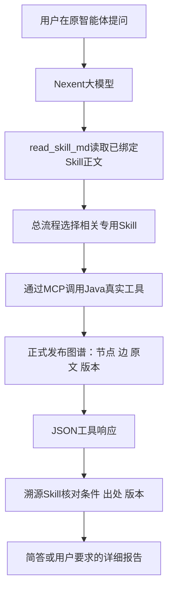

# Nexent 原生 Skills 编排与复用

## 当前进度（2026-11-08）

四个原生Skill已在平台创建、绑定原智能体，并内部发布为 **高血压用药决策助手-2611081425**，保留12个kg-tools-real工具。五道首页独立新对话均已运行，四个Skill均有实际read_skill_md记录。随访和冲突题展示了核心链路；多跳、数值和缺失版本仍有执行或表达遗漏，不能记为全面通过。五个短答均少于200字符，自动知识仍待核验。

实际结果见[本轮验收报告](validation/native-skills-acceptance-20261108.md)及[逐项JSON](../eval/native_skill_acceptance_results_20261108.json)。发布页面、五份页面调用记录和失败草稿均保留。

## 它和已有智能体怎么连接

原智能体是 Nexent 中的“高血压用药决策助手”，不是另建一个聊天应用。Python 建图、Java 读取正式发布图谱的流程继续使用。Skill 增加的是模型执行查询的步骤说明。

本地 `skills/*/SKILL.md` 不会自动出现在远程 Nexent 中，必须先创建平台资源，再在智能体的“工具与技能”中选择。平台把所选 Skill 的名称和描述提供给模型；模型通过 `read_skill_md(skill_name="clinical-evidence-router")` 取得正文。正文指导模型调用已有MCP，Java不读取这些Skill文件。

这四个 Skill 是指令型工作流模板。模型仍需正确执行每一步，不能把它们说成确定性调度器、额外医学知识或已经证明有效的原创算法。

## 四层职责与源码

| 名称 | 本地源码 | 输入及职责 | 后续工具/流程 |
|---|---|---|---|
| clinical-evidence-router | `skills/evidence_router/SKILL.md` | 用户问题；查询当前release，选择查询路径，组织evidence_packet | graph_status、query_relations、lookup_clause、evaluate_blood_pressure、check_references等，按需读取专用Skill |
| clinical-multi-hop | `skills/multi_hop_qa/SKILL.md` | 用药或路径问题及本轮release；同方案组逐跳核对，保留条件 | resolve_regimen、get_evidence；需要通用路径时traverse_relations |
| clinical-conflict-check | `skills/conflict_detect/SKILL.md` | 比较主题及release；核对两侧用途、人群、条件、版本 | detect_conflicts、get_evidence；未命中时补检 |
| clinical-trace-report | `skills/trace_report/SKILL.md` | 本轮真实结果和evidence_packet；逐结论检查出处、条件、pending和版本 | 组织简答或详细报告，不改写知识 |

`evidence_packet` 是模型本轮代码中的组织变量，不是新建数据库或独立服务器。其内容包括问题、实际release、路由、真实调用、路径/断言、出处、条件和未知项。只有真实工具返回过的内容才能写入。

## 为什么这样拆

总流程集中处理版本、JSON字符串解析、检索未命中和分流；专用流程分别处理多跳与冲突；输出层集中检查出处与限制。迁移其他行业时可替换实体、关系与业务工具，同时复用版本一致性和证据核对步骤。当前只提供迁移模板，尚未实测另一行业的部署时间。

MCP回答常是JSON字符串，所以模板明确先 `json.loads`，避免对字符串直接 `.get`。先取得release，后续调用检查同一release；更新中最多重试一次，仍变化则报告无法形成稳定证据包，不拼接两版。

## 平台操作与恢复步骤

1. 登录 `http://192.168.100.150:3000/`，进入“资源仓库 → Skill仓库 → 我的Skill”。四个均已创建，恢复时先检查，避免重复创建。
2. 若迁移到新平台，分别创建四个Skill。可选择安装相应 `.md`；也可交互式创建，填名称/描述，点SKILL.md旁铅笔，把完整源码写入正文后创建。手工编辑器写入前把CRLF转为LF；此前CRLF导致正文校验失败。
3. 保持现有Default Group与组内只读，不扩展权限。
4. 原智能体 `/zh/agents/1` → 工具与技能 → 刷新技能 → 选择上述四个Skill。保留已有12个kg-tools-real工具。
5. 先保存原提示词快照，再在使用要求中追加 `deploy/agent_config_export/native_skill_routing_appendix.txt`。该文件是初始补充文本；完整迭代草稿见constraints_native_skill_draft.txt，发布状态以真实页面记录为准。
6. 草稿调试自然问题，查看是否真正出现read_skill_md及后续MCP调用。确认后发布内部版本，再从首页新对话复测；旧会话不作为新版验证。

导入文件位于 `deploy/skill_packages/<name>.md`，SHA256与源码映射见同目录 `manifest.json`。`clinical-skills-source-bundle.zip` 是四份源码的合集，不保证平台支持一次导入多个Skill。

## 必须保留的实际验收

验收清单：`eval/native_skill_acceptance_cases.json`，最终状态见同目录的验收结果文件；草稿失败过程保留在docs/validation/native-skills-draft-*.txt。与已有 `eval/nexent_acceptance_cases.json` 的医学出处预期配合使用。

每题至少保存：自然问句、草稿/发布版、read_skill_md实际读取名称、MCP真实调用与结果、知识release、最终答复、长度、出处、限制及失败重试。截图和页面文本一起留存，隐藏账号。不以模型声称“使用Skill”代替工具记录，不以本机直接调用MCP代替Nexent平台验收。

普通答案含出处默认200字符以内；详细证据报告单独请求，不能为压缩长度省略决定性条件。糖尿病案例当前为同文跨节两跳，不称跨文档两跳。配备与一线推荐用途不同，不扩大为全文无冲突。140/90的数学边界不能直接当作临床确诊。

## 平台机制的代码依据与限制

已保存官方公开源码参考：`vendor/nexent-reference/read_skill_md_tool.py` 中 `ReadSkillMdTool.name`、`inputs` 与 `execute` 定义读取工具；`skill_loader.py` 解析frontmatter。固定参考commit见同目录 `skill-paths.json`。本地模板使用 `name`、`description` frontmatter，与平台已成功创建的格式一致。

参考来自官方main，不等于当前部署v2.7的所有实现细节；必须通过真实问答确认工具名称、授权和加载行为。此阶段仍未完成表格/图文提取、受控RAG对照、低资源本体算法评估、医学专家核验、平台原生完整配置导出与参赛Word成稿。

## 本轮真实调试发现

1. 模型实际调用了get_evidence，却从响应顶层取text，得到空串。Java的KgToolsService.getEvidence返回QueryResult，原文块在items[0]，正文实际字段是body；只调用工具不等于成功读取原文。
2. 模型写了版本打印，却漏了resolve_regimen响应的版本断言；追加统一checked包装示例。
3. 模型漏初始化evidence_packet，触发NameError；随后又猜错text触发KeyError。失败记录保留，不记为成功。
4. 页面输入后立刻reload会丢失尚未完成的自动保存。修改后先移开焦点，再等待其他工作完成，重载读取核对。
5. Skill是模型读取的步骤说明，仍可能漏执行。提示词要求实际断言和证据包是本轮改进，并不构成平台层强制守卫；尚未证明对所有问法可靠。

## 首页实测怎样说明“接上了”

冲突题在首页真实执行：read_skill_md读取总流程与冲突Skill → graph_status → detect_conflicts → 读取溯源Skill → 两次get_evidence → 在Python检查版本、原文非空、pending提示和字数 → final_answer。记录见native-skills-home-conflict-20261108.txt；这是原平台智能体的调用，不是本机脚本代答。

模型拿到的是工具返回的JSON字符串，执行json.loads后用items读取。[KgToolsService.java](../java-mcp/spring-ai-mcp-server/src/main/java/com/example/ict/mcp/tools/KgToolsService.java) 的getEvidence（114行附近）按block_id查原文并封装为QueryResult；因此读取方式为 `response["items"][0]["body"]`。多跳路径的边在 `items[*].paths[*].steps[*].edge`，首轮误从step顶层取block_id得到空清单，是本轮真实发现的问题。

同方案组组合由Java的DecisionSupport实施，Skill还要求模型核对并保存路径。但首页模型尚未完整执行这项路径断言，缺失版本题甚至漏读溯源Skill。接入成功与执行可靠性是两个验收项目。下一项改进应把版本、路径和输出必需字段核对落到可执行守卫，避免只继续堆长提示词；之后以独立新对话复测，保留本轮失败。
