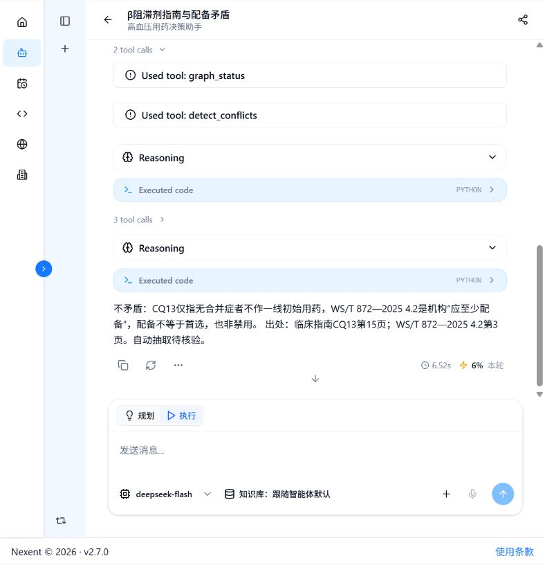

# 原生 Skills 首页验收（2026-11-08）

四个Skill已创建、绑定并内部发布到原“高血压用药决策助手”，版本 **2611081425**，模型deepseek-flash，保留12个kg-tools-real MCP工具。五道首页独立新对话全部运行完毕，四个Skill均有实际读取记录。**接入已完成，完整执行可靠性尚未通过。**

知识版本为 `R-20261107T012120-d13d786332`，published_store模式；自动抽取仍pending。本轮没有更改或删除知识、批准历史提案、申请上架或对外开源。

## 实测结果

| 独立首页问题 | 答案字符数 | 页面耗时 | 结果与主要遗漏 |
|---|---:|---:|---|
| 达标/未达标多久随访 | 119 | 7.66s | 真实读取总流程、溯源Skill和3个原文；频次、至少、直至达标及两份出处保留。短答漏转诊条件，不能称全部条件覆盖。 |
| 合并糖尿病首选方案 | 134 | 8.92s | 真实读取总流程、多跳、溯源Skill，调用resolve_regimen及3个原文；保留择一、不宜联用和版面疑点。首次取错路径层级后自修正，重复查询，未执行同方案组断言，扩写未问的C/D。 |
| 140/90是否高血压 | 79 | 5.11s | 参数保留measurement_method=unknown；边界与确诊、4周内非同日3次规范且每次达界得到保留。最终没有明确说明测量方式未知，打印file_name得到None。 |
| β阻滞剂配备与一线推荐是否矛盾 | 111 | 6.52s | 实际读取总流程、冲突及溯源Skill，detect_conflicts加两块原文。正确区分机构药物保障与无临床合并症初始用药，未扩大成全文无冲突。只验证本题，真冲突与更多问法未验收。 |
| 索要2021版诊断阈值逐字原文及页码 | 128 | 12.34s | 未编造2021版阈值。但漏读溯源Skill、引用查询未纳入版本检查、重复重置证据包；末句“引用版本为2025候选”错误混淆引用2021与现有候选2025，漏第4页版面待核验。完整流程不通过。 |

字符数按保存页面中最终答复计数，换行在AX中表现为空格；五题均在200字符内。耗时只是页面单次显示，不能作受控性能比较。未把单次成功转换为准确率或稳定性结论。

## 原始证据与复现

- [发布页面](native-skills-published-20261108.txt)与[绑定页面](native-skills-binding-20261108.txt)。
- [随访](native-skills-home-followup-20261108.txt)、[多跳](native-skills-home-multi-hop-20261108.txt)、[数值](native-skills-home-threshold-20261108.txt)、[冲突](native-skills-home-conflict-20261108.txt)、[缺失版本](native-skills-home-missing-version-20261108.txt)：包含自然问题、模型代码、工具调用及最终答案。
- [逐项结构化结果](../../eval/native_skill_acceptance_results_20261108.json)：包含问题、状态、长度、实际MCP次数、证据SHA256、成功点及遗漏。
- [手工配置快照](../../deploy/agent_config_export/agent_native_skills_snapshot_20261108.json)：12工具、4个Skill源码映射与SHA、完整使用要求；不是平台原生导出格式。
- 草稿失败和修正保留在 `native-skills-draft-multi-hop*.txt`；r4核心读取无报错，不代表完全遵循。没有删除失败记录或旧发布版。

复现时进入首页“开始问答”，点新对话，选择原智能体，再原样输入五个问题。每题新建独立对话，展开read_skill_md及业务工具，核对真实参数、返回原文和最终答复。已有旧会话不能代替新版独立验证。

页面中的MCP结果经过模型print，部分限制为前200/3000/4000字符；AX记录不等于未截断的原始全量协议日志。部分题只在运行时通过checked检查版本，没有在保存页面打印具体release值，此限制也记入JSON。

截图裁掉了含账号的页眉，保留智能体标题、Nexent版本、实际工具及答复。

## 这轮具体怎么完成

1. 四份本地SKILL.md创建为平台资源，再在原智能体“工具与技能”选中；本地文件不会自行上传到远程平台。
2. 使用要求增加实际read_skill_md、JSON解析、evidence_packet和版本/字数检查。发现get_evidence响应正文是items[0].body，修正此前text层级错误，重载核对自动保存后的内容。
3. 草稿调试保留NameError、KeyError、空证据等失败；核心链路运行后内部发布，最后在首页独立验收。没有以本机MCP测试冒充Nexent问答。
4. 比较Skill要求与页面实际代码，而不只看最终答案。由此发现模型仍会跳步骤：工具能读到，不代表每轮严格执行。

实现和连接说明见[原生Skills编排与复用](../12-Nexent原生Skills编排与复用.md)。Java服务负责真实图谱查询和同方案组组合；Skill是模型读取的步骤说明，不是强制执行器。

## 后续修复顺序

先为版本、路径层级、证据必需字段及缺失版本终止条件提供可执行核对，减少依赖模型临时编写长代码；随后用独立新对话复测多跳、数值及缺失版本，并检查随访转诊限制。上述守卫尚未实现，不能提前宣称已修复。

这之后仍有比赛缺口：表格勾选/图文资产处理、低资源本体半自动构建与人工投入评估、受控RAG对照、更充分的跨文档多跳、医学专家核验、平台原生完整配置导出和Word提交稿。当前仅为阶段性交付。
